 

 

## 🏅 Certifications

## 🧰 Tech stack

<table>
  <tr>
    <td align="center" width="140"><b>Backend</b></td>
    <td>
       
      
      
      
      
      
      
    </td>
  </tr>
  <tr>
    <td align="center"><b>Data &amp; Messaging</b></td>
    <td>
       
      
      
      
      
      
    </td>
  </tr>
  <tr>
    <td align="center"><b>DevOps &amp; Cloud</b></td>
    <td>
       
      
      
      
      
    </td>
  </tr>
  <tr>
    <td align="center"><b>Testing</b></td>
    <td>
      
      
      
      
      
      
    </td>
  </tr>
  <tr>
    <td align="center"><b>Frontend</b></td>
    <td>
      
    </td>
  </tr>
  <tr>
    <td align="center"><b>AI</b></td>
    <td>
      
      
      
      
      
    </td>
  </tr>
</table>

## 🏗️ What I've built

  
  
  
  

## 🧪 Side projects

  
  

## 📊 GitHub activity

<picture>
  <source media="(prefers-color-scheme: dark)" srcset="https://raw.githubusercontent.com/MentTea/MentTea/output/snake-dark.svg">
  <source media="(prefers-color-scheme: light)" srcset="https://raw.githubusercontent.com/MentTea/MentTea/output/snake-light.svg">
  
</picture>

 

